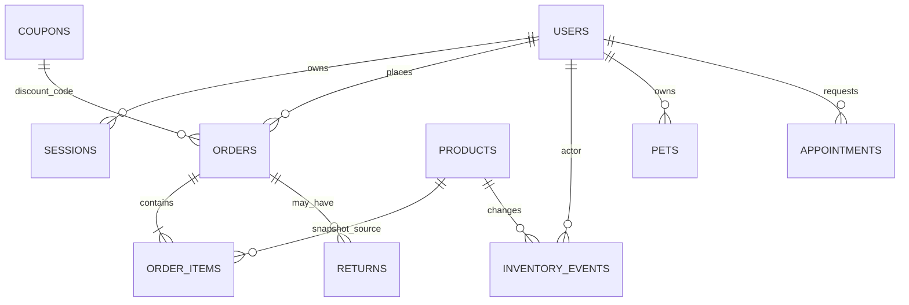

# 03 · Database design

## Physical database

SQLite with WAL mode, foreign keys, 15-second busy timeout, versioned initial schema at `db/migrations/001_initial.sql`, and seed catalog in `backend/database.py`. It is an evidence-based MVP choice for one Lightsail VM and a $200 credit cap; it avoids a separate database instance and supports atomic checkout. The application must remain a single process/instance while using this file. For multi-instance or higher concurrent writes, migrate to PostgreSQL and move sessions/rate limits to shared services.

## ERD

## Tables, constraints and access patterns

- `users`: unique case-insensitive email, customer/admin roles, PBKDF2 password hash.
- `sessions`: SHA-256 digest of random cookie token and expiry; indexed by expiration.
- `products`: unique slug/SKU, integer VND prices, nonnegative stock, active and featured flags; category/species indexes for catalog filters.
- `orders`: unique order code, optional user, address/contact snapshot, integer totals, payment method and constrained status; indexes status/date and phone for admin queues and order lookup.
- `order_items`: product name and price snapshots, positive quantity, cascade with order.
- `inventory_events`: append-only signed deltas with reason and actor.
- `coupons`: percent/fixed discount, minimum subtotal, usage limit/count and active flag.
- `appointments`: service, pet/owner/contact, requested date/time/staff, status, unique staff/date/time constraint.
- `pets`: customer pet records (schema ready; UI CRUD is Phase 2).
- `returns`: request status and reason linked to an order.
- `settings`: store-level key/value configuration.

## Transactions, migrations, retention and recovery

Checkout uses `BEGIN IMMEDIATE`, validates stock again after locking, writes order/items, adjusts inventory and consumes coupon before commit. Failure rolls back all writes. The initial schema is idempotent but later schema changes must be added as numbered migrations with tested forward/backup recovery. Keep DB file and assets on a persistent disk; back up the SQLite database using the SQLite backup API or a quiesced snapshot, encrypt snapshots, and rehearse restore before accepting real payments. Retention/deletion policy for customer PII and order records must be decided before production.
