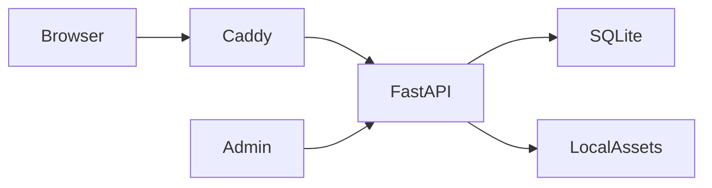

# 04 · Implementation and AWS handoff

## Technology decision

Scores are 1 (weak) to 5 (strong) for this specific low-traffic shop/pilot, small budget, AWS single-instance goal. Operational simplicity and cost receive extra attention; this is not a universal benchmark.

| Option | UI fit | Dev effort | Runtime cost | Ops simplicity | Relational fit | Total / 25 |
|---|---:|---:|---:|---:|---:|---:|
| FastAPI + static HTML/CSS/JS + SQLite | 4 | 5 | 5 | 5 | 3 | **22** |
| Next.js + PostgreSQL on same VM | 5 | 3 | 4 | 3 | 5 | 20 |
| ECS Fargate + RDS PostgreSQL | 5 | 3 | 2 | 2 | 5 | 17 |

Selected: Python 3.12/FastAPI API, browser-native frontend in `frontend/`, SQLite migration/schema in `db/`, one Lightsail VM with Caddy TLS reverse proxy. This is simplest to run within a small credit budget. Tradeoff: one VM is a single point of failure and SQLite is not the final database choice for a busy store.

## Deployment topology

## AWS credit fit (estimate, not an account-specific quote)

AWS currently lists a Lightsail Linux bundle at **$12/month** with 2 GB memory, 2 vCPUs, 60 GB SSD and 3 TB transfer. A single low-traffic MVP on that VM costs about $12/month before taxes, optional snapshots/domain and overages; $200 would arithmetically cover about 16 months at that base price, but the actual AWS credit eligibility/expiry and your region/account plan control the bill. AWS states credits have limits/expiry and can fail to cover ineligible fees; check Billing → Credits and configure spend limits/alerts. See official Lightsail pricing and AWS credit terms linked from the handoff response.

## Deployment checklist

1. In Lightsail, create an Ubuntu VM in Singapore or Mumbai, choose the 2 GB / $12 bundle (verify current regional price) and attach static IP.
2. Restrict SSH to your own IP; open TCP 80/443 publicly. Add a domain DNS A record to the static IP if you have a domain.
3. Install Docker Engine and Compose, upload this project archive, copy `.env.example` to `.env`, set `APP_SECRET` to a unique random string, set a strong `ADMIN_PASSWORD`, and set `PUBLIC_BASE_URL=https://your-domain`.
4. Set `CADDY_SITE=your-domain` in `.env`, run `docker compose up -d --build`, then check `/api/health` and `/admin`.
5. Configure snapshots/backups and CloudWatch billing alerts. Test restore before real orders.
6. Add provider credentials only in AWS Secrets Manager/SSM for payment, SMS/email or shipping integrations; do not put them in the frontend or commit `.env`.

No AWS CLI or AWS credentials were available in this workspace, so no AWS resources were created and no live URL is claimed. `deploy/aws/deploy-lightsail.md` and Docker artifacts are prepared for the account owner to run.

## Remaining production gates

- Configure a real payment provider + signed webhook and test in sandbox; configure shipping and order notifications.
- Decide customer data retention and staff permissions; implement audit logs, backups and restore rehearsal.
- Move sessions/rate limiting off process memory and database to PostgreSQL before horizontal scaling.
- Supply licensed product photographs and verified catalogue copy; current products/prices are seeded demo content.
- Review TLS/domain, security headers/CSP, abuse protection, accessibility and real mobile-device behavior.
